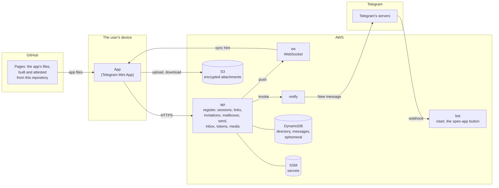

# How it works

An overview of the parts and how a message travels. The exact formats are in
[protocol.md](protocol.md); what this protects and where it stops is in
[security.md](security.md).

## Parts

- **The app** is one static web app (TypeScript, Preact, Vite) that runs as a
  Telegram Mini App. All encryption happens in it, with the browser's own
  WebCrypto. It loads no third-party code at runtime: not even Telegram's
  `telegram-web-app.js`, which changes in place and can't be pinned; a small
  bridge of its own speaks Telegram's documented web-events protocol instead.
- **The backend** is four Go functions on AWS Lambda, one per trust boundary,
  three DynamoDB tables and one S3 bucket. Only `bot` and `notify` can read the
  bot token.
- **The bot** only welcomes people, opens the app, and sends generic notices.
  It never sees content.
- **Hosting:** the app is served by GitHub Pages from a hosting repository in a
  GitHub organization of its own, which builds, attests and deploys it
  ([verifying.md](verifying.md), [hosting/](../hosting/README.md)).

## Accounts

- **Accounts are keys, not Telegram users.** An account is an account key and
  a device key, made on the device. The server knows the account by a random
  ID.
- **Registration happens inside Telegram only**, which gives phone-backed
  anti-spam for free. The app reopens itself through its own link with a code
  derived from the new account key, so Telegram's signed launch data (checked
  with Telegram's Ed25519 key, not the bot token) carries that code. The
  server stores only a keyed hash of the Telegram user ID, to keep one account
  per Telegram user.
- **One device per account.** History lives only on that device. Setting up
  on another device replaces the account, after a typed confirmation: the old
  account's links and mailboxes end at once, and the old device says so, and
  that it may mean tampering. A second device that finds an account elsewhere
  says "your account is on another device" instead of offering setup.
- **Deleting an account** (in the app, after a typed confirmation) removes
  everything the server holds for it at once, keeping no marker, and then
  everything on the device. Nobody is told; messages to its old link and
  mailboxes go nowhere.
- **Several Telegram accounts in one Telegram app** share one storage area, so
  each gets its own local profile on the device, named after a hash of its
  Telegram user ID.
- **Sessions:** the device signs a login with its device key and gets a
  15-minute token. Sensitive actions (links, invitations, admin) also carry a
  fresh signature.

## Links

A link is `https://t.me/<bot>/<app>?startapp=<payload>`, where the payload
holds a random link ID and the **fingerprint** of the link's signing key. The
server keeps the link's **bundle**: the signing key, its current encryption
key (signed by it), and the link's intro mailbox.

- Opening a link, the app fetches the bundle without logging in and checks
  the fingerprint and signatures before encrypting anything. A server that
  swaps keys is caught.
- An account has one link at a time, and can replace it: the old link stops
  working at once, the new one keeps the same fingerprint, so blocks and labels
  carry over.
- While the service is invite-only, owning a link needs an invitation.
  Anyone with Telegram can set up an account to write to a link.

## Conversations and mailboxes

The server routes by **mailbox**, never by account. A mailbox is a random
128-bit ID owned by one account; the server knows its owner, to deliver, but
never who writes to it. Mailbox IDs only travel inside encrypted messages.

1. A sender opens a link and checks its bundle.
2. Their app makes a conversation ID and a fresh **conversation key** for this
   one conversation, and takes a reply mailbox from a pool it keeps (refilled
   at random times, so taking one doesn't happen right before a send).
3. The first message goes to the link's intro mailbox. Inside the encryption:
   the conversation key, the reply mailbox, a **sender tag** and the text.
4. The owner's app shows a new conversation. When the owner replies, their app
   takes a mailbox of its own for it; from then on each side writes to the
   other's mailbox, and to the other's conversation key.

Each side only ever sees the other as that conversation's key. Two people the
same sender wrote to see unrelated keys and mailboxes, so they can't compare
notes. If the owner also writes to the sender's own link, that's a separate
conversation with nothing shared.

**Labels** like `🦊 K3F9` are computed on the device from the account's own
secret: one person keeps the same label through the same link.

## Messages

- **Encryption:** each message gets a random content key; the body is
  AES-256-GCM, and the content key is wrapped for the recipient's current key
  with HPKE (RFC 9180, P-256, single shot), written against WebCrypto and
  checked with the RFC's test vectors.
- **Authentication:** an HMAC tag with a key both sides can compute. The
  recipient knows who wrote, but can't prove it to anyone else (deniable). The
  server holds neither key, so it can't forge one.
- **Padding:** inner messages are padded to a few fixed sizes.
- **Replies, reactions, "seen", deletes and blocks** are encrypted messages too. "Seen"
  is sent the moment a message is read. A reaction is one emoji per side per
  message, from a quick row in the long-press menu or the full emoji picker;
  a double-tap reacts with ❤️, as in Telegram.
  Deleting one of your own messages deletes it on both sides by default (the
  other side's app is asked to; see the limits in the security model). A
  whole conversation can be deleted on both sides too, if chosen. Blocks are silent: the blocked side's sends
  still look accepted, and new conversations from the same person through the
  same link are dropped by their sender tag.
- **Key rotation:** conversation and link encryption keys are replaced every
  6 to 9 days, each on its own random schedule, and old private keys are
  deleted 35 days later.

## Sending, delivery and notices

- **Send tokens:** every send spends one anonymous token, without logging in.
  Tokens are RSA blind signatures (RFC 9474, in Privacy Pass's shape): the
  app fetches a batch while logged in (at most 200 a day), and the server
  can't link a spent token to the account it signed it for. The issuer's
  public key is published in [`web/issuer-keys.json`](../web/issuer-keys.json),
  and the app accepts no other, so the server can't tell users apart by key.
- **Caps:** at most 30 messages a minute to one mailbox, and 60 first messages
  an hour through one link.
- **Delivery:** the server stores each envelope for the mailbox owner's device
  until it confirms it, at most 30 days. Unknown, ended and blocked mailboxes
  get the same answer, and nothing is stored.
- **Push:** an open app keeps a WebSocket while it's visible. After a delivery,
  the server sends it a content-free "sync" hint, and the app fetches.
- **Notices:** if no app took the push, the bot sends a generic "New message"
  in the user's language: no names, no counts, at most one every 3 minutes,
  replacing the previous one. "Seen" receipts and reactions never trigger one.

## Attachments

Photos, videos, GIFs, files, music, voice messages and round video messages
are encrypted on the device with a fresh key for each file, padded, and
uploaded straight to an S3 bucket with a presigned URL whose exact size is
part of its signature. The upload is paid with send tokens (one per started
5 MiB, files up to 25 MB), not a login. The message carries the file's key;
the server never sees a key, name or type.

- Photos are redrawn on the device (up to 1280 px), which drops their
  metadata; videos keep their pictures but lose location and time metadata;
  voice and video messages are recorded in the app and carry none. Files are
  sent untouched.
- The recipient fetches the upload by its unguessable ID, decrypts it and
  keeps it on the device, encrypted under the device's storage key. Photos,
  voice and video messages and GIFs up to 10 MB download as soon as their
  conversation is open (each kind can be turned off); the rest on a tap.
- **Data and storage** shows the space attachments take, and clears them from
  the device after a month or a week, or on request, keeping their messages.
  A cleared attachment downloads again on a tap while its upload exists.
- **Saving to the device:** a Mini App can't hand a file to the phone, so the
  app uses the share sheet where there is one, and otherwise opens a save page
  in the device's own browser. The file's key travels after the `#` in that
  address, which is never sent to a server.
- The upload is deleted when the recipient deletes the message or the
  conversation, and in any case after 31 days. Downloading or saving it
  doesn't, so a cleared attachment can be fetched again meanwhile. The bucket
  keeps no versions and no access logs.

## Emoji and stickers

The panel under the message box has emoji and stickers, as in Telegram.

- **Emoji** are the phone's own, typed into the message: the app ships only the
  list, by category, from Unicode's data (up to Emoji 14.0, so older phones
  show them all; `web/src/emoji/make-data.mjs`). Recently used ones are kept
  in memory only.
- **Stickers:** three packs are part of the app's build (Microsoft's Fluent
  Emoji, MIT licensed). Sending one sends only its name, and nothing is
  uploaded. The app fetches all the images at once when a conversation
  opens, never per sticker, so the host learns nothing about which are used.

## The app on the device

- **Storage:** IndexedDB only. Private keys are non-extractable WebCrypto keys
  where possible; keys that must stay copyable are sealed under a
  non-extractable vault key. History and attachments are encrypted under a
  non-extractable storage key.
- **Several copies at once** (a reopened app, several windows) share storage,
  so they coordinate with Web Locks and announce changes over a
  BroadcastChannel.
- **Lockdown:** a strict Content Security Policy (only the app's own scripts;
  connections only to the API, the socket and the bucket), Trusted Types, one
  deterministic JavaScript file, and no code or settings loaded from the
  backend.
- **Languages:** English and Persian, right-to-left included, with Telegram's
  theme mapped onto the app's own colours.

## The backend

| Function | Entry | Can read |
|---|---|---|
| `bot` | Telegram webhook (function URL, checked with a random webhook secret) | the bot token |
| `api` | all HTTPS routes (function URL) | the session key, the Telegram-ID pepper, the send-token issuer key; the tables; the bucket |
| `ws` | WebSocket connect and disconnect | the session key; socket records only |
| `notify` | invoked by `api` | the bot token and the key that opens chat IDs |

| Table | Holds | Expires |
|---|---|---|
| `directory` | accounts (keyed Telegram-ID hash, sealed chat ID, public keys, invitation level), links and bundles, mailbox owners, invitations | mailboxes expire |
| `messages` | one item per undelivered envelope: the device, the mailbox, the ciphertext. No sender, no account | 30 days |
| `ephemeral` | socket connections, rate counters, login nonces, spent send tokens, upload records (size and the hash of a delete secret) | minutes to 31 days |

- No precise timestamps: keys are random IDs, and times are rounded.
- Point-in-time recovery stays off, so deleted data can't be restored.
- Secrets live in SSM, written through Terraform's write-only arguments, so they
  never land in Terraform state. Each function's role reads only its own.
- Logs: warnings and errors only, kept 7 days. IDs, IP addresses, user agents
  and bodies are never logged, and there are no API access logs.
- Code signing: the functions run only code signed by CI's AWS Signer
  profile, and each deploy checks that the running code is the attested build
  ([verifying.md](verifying.md#the-backend)).
